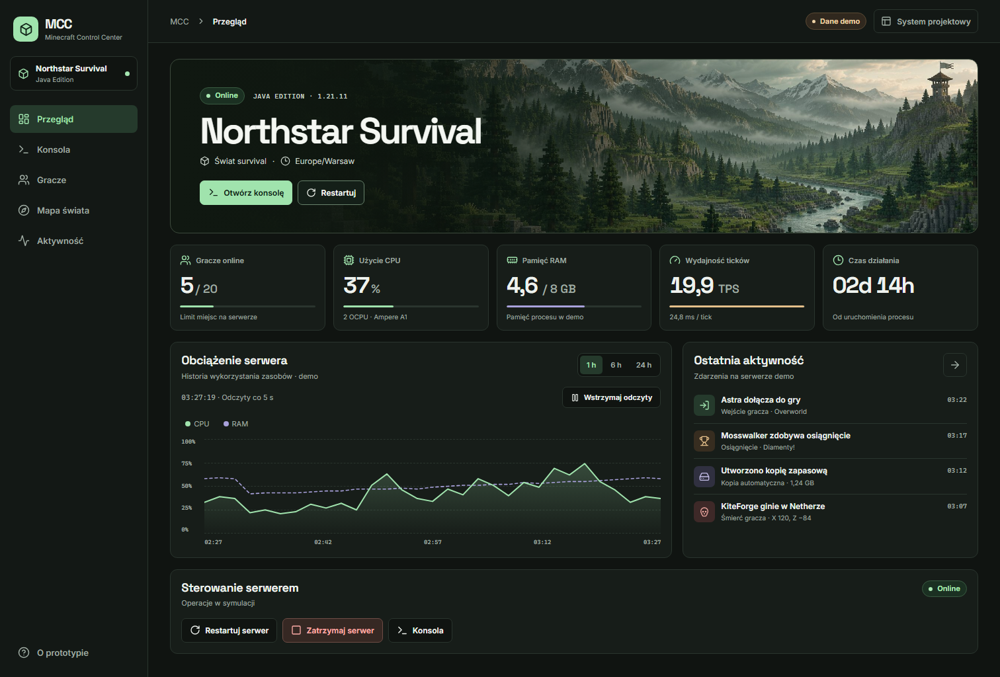
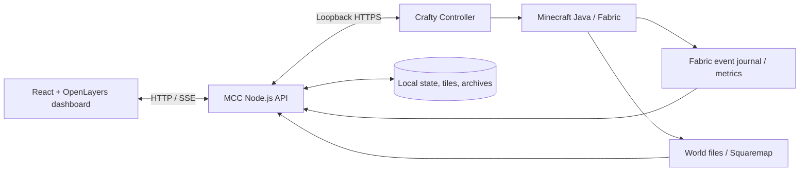

# Minecraft Control Center

A web dashboard for operating a private Minecraft Java Edition server. MCC brings server health, player activity, the world map, and routine administration into one interface backed by a local Node.js API.



*The running dashboard in demo mode. Metrics, player names, and activity shown here come from the demo.*

## Capabilities

| Area | Implementation |
| --- | --- |
| Monitoring | Server stats, process state, logs, activity, and retained metric history. The browser receives live updates over Server-Sent Events. |
| World and players | OpenLayers map, published world tiles and Squaremap integration, live positions when available, player inventory and profiles, death locations, and shared waypoints. |
| Server operations | Start, stop, and restart through Crafty. An allowlist and separate access checks gate supported game commands. File and mod operations have their own controls. |
| Backups | Inspect and request Crafty backup jobs, browse configured archives, restore a world under guarded conditions, and import or restore encrypted offsite bundles using CLI tools. |
| Private access | Account sessions and role checks. A configured deployment can use Web Push and serve the built frontend from the same backend. |

## Architecture

**Stack** · React 19, TypeScript, Vite, OpenLayers, Node.js with native HTTP, Server-Sent Events, Web Push, Crafty Controller, and an optional Java 21/Fabric mod for Minecraft 1.21.11.



The backend polls Crafty and configured server-side sources, normalizes their output, and publishes updates to the browser. Privileged requests pass through the session and capability checks before reaching Crafty or filesystem handlers. Offsite CLI operations use a separate encrypted bundle workflow. The demo entry point uses synthetic state in the browser and requires no Minecraft server.

## Run the demo

Use Node.js 22.12+ on the 22 line, or Node.js 24+. From the repository root:

```sh
npm ci
npm run dev
```

Open `http://127.0.0.1:5173/?mode=demo#observatory/overview`. Try **Overview**, **Console**, **Players**, or **World Map**. Stop or restart from the demo dashboard to see the simulated server state change.

### Connect a private server

1. Copy `examples/crafty.example.json` to a private location outside the checkout and set `MCC_CRAFTY_CONFIG` to that absolute file path. Populate the server UUID, server name, PEM certificate, read token, and loopback HTTPS URL for your Crafty instance or tunnel.
2. Run `npm run api` and `npm run dev` in separate terminals with the same environment. Open `http://127.0.0.1:5173/?mode=live`. The API listens on `127.0.0.1:4174`. If the site requires sign-in, create a viewer with `npm run account -- demo-viewer viewer --setup-file`. The initial password is written to a private file beside the account store.
3. Set up feature-specific credentials and local files as needed. Power control, commands, and backup jobs use separate Crafty credentials. Shared files, the Fabric journal, the map feed, and restoration require the relevant server paths and permissions. Write operations need explicit configuration.

## Verify and package

```sh
npm run check
npm test
npm run build
npm run release -- 0.1.0-20261121.1
```

The audit verified the demo in Chromium, TypeScript checking, the Vite production build, and release packaging. The Node test suite passed 63 tests and skipped two filesystem cases on Windows. The Fabric event mod built with JDK 21 and Gradle 9.2.1. Its sources and Gradle configuration live in `apps/fabric-world-events/`. The audit used local fixtures for the backend and did not connect to a live Crafty instance.

**Status** · MCC 0.1.0 includes a usable offline demo and integrations for a private server. Live features depend on Crafty permissions, installed Fabric/Squaremap components, local files, and deployment configuration. Possible next steps include a disposable live integration fixture, a CI build for the Fabric module, and scripted Linux restore checks.

The project was developed with AI assistance. The landscape and map artwork in the demo were generated for the project.
